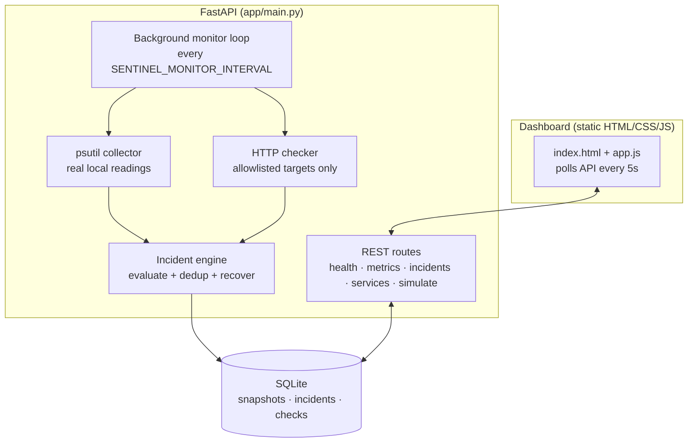

# CloudOps Sentinel

A **local-first infrastructure monitoring, health-check, and incident troubleshooting platform**. It watches your computer's CPU, memory, and disk, checks HTTP services, raises incidents when thresholds break, and tracks each incident until recovery — all on your own machine, with no cloud account, paid API, or external service required.

> **Honest scope:** this is a local-first learning/portfolio tool, not a production cloud monitoring platform. CPU/RAM/disk readings are real local observations (via `psutil`); warning/critical demo scenarios are explicitly labelled `simulated` and never stress your machine.

## Problem statement

Junior support/operations engineers need to answer three questions fast: *is something wrong, what is the evidence, and who is handling it?* CloudOps Sentinel gives a single dashboard for live system health, metric history, service checks, and an incident queue with acknowledge/resolve workflow.

## Features

- **Live system metrics** — real CPU, memory, disk, uptime via `psutil`
- **Metric history** — SQLite-backed snapshots with trend chart
- **Health summary** — `healthy` / `degraded` / `critical` from active incidents
- **Incident engine** — configurable warning/critical thresholds, one active incident per condition (dedup), auto-recovery when conditions clear
- **HTTP service checks** — timeout-protected checks against explicitly configured targets only, with SSRF validation (http/https, no embedded credentials, no dangerous schemes)
- **Controlled fixtures** — `/api/test/ok` and `/api/test/fail` so failures are demonstrable offline
- **Demo scenarios** — deterministic `simulated` incidents (CPU warning/critical, memory, disk, service failure, recovery) without harming the host
- **Operations dashboard** — responsive plain HTML/CSS/JS with loading, empty, and error states
- **Tests, Docker, CI** — pytest suite, Dockerfile + Compose, GitHub Actions workflow

## Technology stack

| Layer | Choice |
|---|---|
| Language | Python 3.12+ |
| API | FastAPI, Pydantic v2 |
| ORM / DB | SQLAlchemy 2.x, SQLite |
| Metrics | psutil |
| HTTP checks | httpx (timeout-guarded) |
| Frontend | Plain HTML, CSS, JavaScript (no framework) |
| Tests | pytest + FastAPI TestClient |
| Containers / CI | Docker, Docker Compose, GitHub Actions |

## Architecture



## Installation (Windows PowerShell)

Prerequisites: Python 3.12+ and Git.

```powershell
git clone https://github.com/<your-username>/cloudops-sentinel.git
cd cloudops-sentinel
python -m venv .venv
.\.venv\Scripts\Activate.ps1
pip install -r requirements.txt
```

If script execution is blocked, use `Set-ExecutionPolicy -Scope CurrentUser RemoteSigned` (current user only), or run `.\.venv\Scripts\python.exe -m pip install -r requirements.txt` without activating.

## Installation (Linux / macOS)

```bash
git clone https://github.com/<your-username>/cloudops-sentinel.git
cd cloudops-sentinel
python3 -m venv .venv
source .venv/bin/activate
pip install -r requirements.txt
```

## Run locally

```powershell
.\.venv\Scripts\Activate.ps1
uvicorn app.main:app --host 127.0.0.1 --port 8000
```

Then open **http://127.0.0.1:8000** (dashboard) and **http://127.0.0.1:8000/docs** (OpenAPI docs).

Useful environment variables:

| Variable | Default | Purpose |
|---|---|---|
| `SENTINEL_CPU_WARN` / `SENTINEL_CPU_CRIT` | 75 / 90 | CPU thresholds (%) |
| `SENTINEL_MEM_WARN` / `SENTINEL_MEM_CRIT` | 80 / 90 | Memory thresholds (%) |
| `SENTINEL_DISK_WARN` / `SENTINEL_DISK_CRIT` | 80 / 90 | Disk-used thresholds (%) |
| `SENTINEL_MONITOR_INTERVAL` | 30 | Background check interval (s) |
| `SENTINEL_SERVICE_TIMEOUT` | 5 | HTTP check timeout (s) |
| `SENTINEL_ENABLE_MONITOR` | 1 | Set to `0` to disable background loop |
| `DATABASE_URL` | `sqlite:///./data/sentinel.db` | Database location |

## Run tests

```powershell
.\.venv\Scripts\Activate.ps1
pytest -q
```

Tests are deterministic: `psutil` readings and HTTP calls are mocked, there is no dependency on GCP, the internet, or heavy resource usage.

## Docker

```bash
docker build -t cloudops-sentinel .
docker run -p 127.0.0.1:8000:8000 -v sentinel-data:/app/data cloudops-sentinel
# or
docker compose up --build
```

The SQLite database persists in the `sentinel-data` volume (`/app/data`). A container health check polls `/api/health`.

## API documentation

Interactive docs: `/docs` (Swagger) and `/redoc`. Key routes:

| Method | Route | Description |
|---|---|---|
| GET | `/api/health` | App + DB health, uptime |
| GET | `/api/metrics/current` | Live reading (also stored) |
| GET | `/api/metrics/history?limit=60` | Recent snapshots |
| GET | `/api/metrics/summary` | Overall status + active counts |
| GET | `/api/incidents?status=&severity=` | List / filter incidents |
| GET | `/api/incidents/{id}` | Incident detail |
| POST | `/api/incidents/{id}/acknowledge` | Claim an open incident |
| POST | `/api/incidents/{id}/resolve` | Close an incident |
| GET/POST/DELETE | `/api/services…` | Targets, `/{id}/check`, `/history` |
| GET | `/api/test/ok`, `/api/test/fail` | Controlled offline fixtures |
| POST | `/api/simulate` | Demo scenarios (`cpu_warning`, `cpu_critical`, `memory_critical`, `disk_critical`, `service_failure`, `clear`) |

Errors are consistent JSON: `{"detail": "…"}` (validation failures return `{"error": "validation_error", "detail": […]}`).

## Demo walkthrough

1. **Normal health** — open the dashboard; badge shows HEALTHY, bars show live readings.
2. **Warning threshold** — Dashboard → *Demo scenarios* → *CPU warning*, or `POST /api/simulate {"scenario":"cpu_warning"}`. A `warning` incident appears (tagged `simulated`).
3. **Critical threshold** — run *CPU critical*. The existing warning escalates to one `critical` incident (no duplicate), badge turns CRITICAL.
4. **Service failure** — add target `http://127.0.0.1:8000/api/test/fail`, press *Check now*: a `service_down` incident appears. (Point it at `/api/test/ok` and check again to see recovery.)
5. **Recovery & history** — press *Clear / recover* (or `{"scenario":"clear"}`): simulated incidents resolve with timestamps; filter the incident list by *Resolved* to review history.

## Troubleshooting

| Symptom | Fix |
|---|---|
| `pip install` fails on Windows | Upgrade pip: `python -m pip install --upgrade pip`; ensure Python 3.12+ from python.org |
| Port 8000 in use | `uvicorn app.main:app --port 8001` |
| Empty dashboard / unreachable badge | Backend not running — start uvicorn; check `http://127.0.0.1:8000/api/health` |
| DB locked | Only one writer loop at a time; stop duplicate servers |
| PowerShell activation blocked | Use `.\.venv\Scripts\python.exe -m uvicorn app.main:app --host 127.0.0.1 --port 8000` directly |

## Limitations

- Single-node, local-only: no multi-host, alerting integrations, or auth (binds to localhost by default).
- Thresholds are static (no anomaly detection); background interval minimum ~seconds.
- History is trimmed (5000 snapshots / 2000 check results) to bound SQLite growth.
- Simulated scenarios are fixtures, not real load — by design, to stay safe.

## Future improvements

- User authentication + role-based incident assignment
- Email/webhook notifications on critical incidents
- Configurable per-service expected status codes and response-time SLOs
- Metrics retention policies + CSV export
- Optional Prometheus exposition endpoint

## Task checklist

- [x] Environment inspection
- [x] Backend (health, metrics, incidents, services, simulation)
- [x] Monitoring + incident engine (thresholds, dedup, recovery)
- [x] Safe HTTP service checks (allowlist + validation + timeouts)
- [x] Dashboard (live data, states, ack/resolve controls)
- [x] Pytest suite (deterministic, mocked)
- [x] Docker + Compose + CI workflow
- [x] README + demo walkthrough
- [ ] GitHub publication (requires `gh` auth — see final report)

## License

MIT — see [LICENSE](LICENSE).
