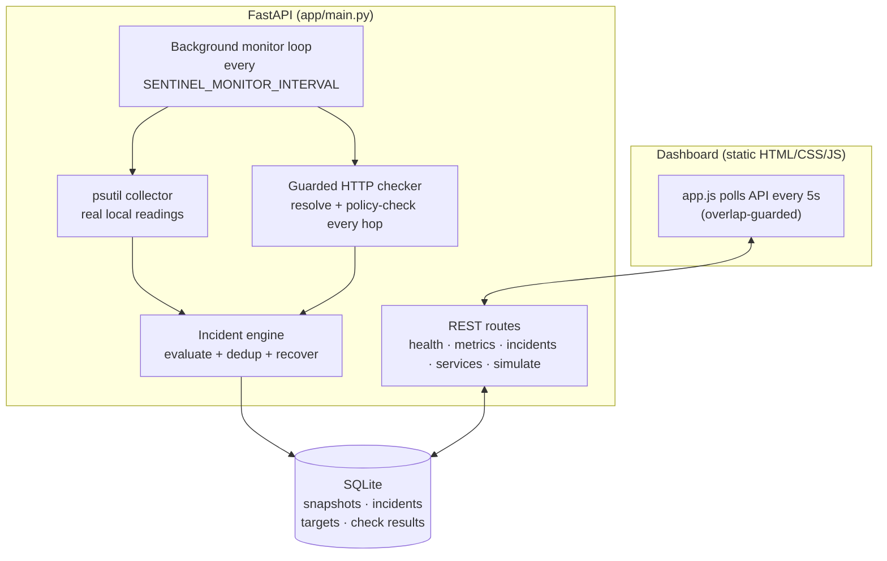

# CloudOps Sentinel

Local-first infrastructure monitoring, health-check, and incident troubleshooting — built with FastAPI, SQLite, and `psutil`. It watches your computer's CPU, memory, and disk, checks HTTP services, raises incidents when thresholds break, and tracks each incident until recovery. No cloud account, paid API, or external service required.

**Repository:** https://github.com/Vardhan32/cloudops-sentinel

> **Honest scope:** a local-first learning/portfolio tool, not a production cloud monitor. CPU/RAM/disk readings are real local observations; demo scenarios are explicitly labelled `simulated` and never stress your machine. See [Security](docs/SECURITY.md) for hardening and known limitations.

## Why this exists

Support and operations engineers answer three questions fast: *is something wrong, what is the evidence, and who owns it?* This project puts live health, metric history, service checks, and an acknowledge/resolve incident queue behind one dashboard and a documented REST API.

## Features

- **Live metrics** — real CPU / memory / disk / uptime via `psutil`, stored as SQLite snapshots
- **Health summary** — `healthy` / `degraded` / `critical` derived from active incidents
- **Incident engine** — warning/critical thresholds, one active incident per condition (dedup + escalation), auto-recovery, ack/resolve workflow with timestamps
- **Guarded HTTP service checks** — per-request DNS resolution + policy check, redirect re-validation (max 3 hops), short timeouts, 256 KiB body cap, connection-pool limits
- **Offline fixtures** — `/api/test/ok`, `/api/test/fail`, plus one-click dashboard quick-add
- **Labelled demos** — deterministic `simulated` scenarios, fully separated from `observed` data
- **Dashboard** — dependency-free HTML/CSS/JS with loading, empty, and error states, toast feedback, mobile-usable layout
- **Quality gates** — 94-test pytest suite, Docker + Compose, GitHub Actions (tests + image build)

## Architecture



Detail: [docs/ARCHITECTURE.md](docs/ARCHITECTURE.md) · [docs/SECURITY.md](docs/SECURITY.md) · [docs/PROJECT_AUDIT.md](docs/PROJECT_AUDIT.md)

## Tech stack

Python 3.12+ · FastAPI · Pydantic v2 · SQLAlchemy 2.x · SQLite · psutil · httpx · pytest · plain HTML/CSS/JS · Docker / Compose · GitHub Actions. Pinned versions in `requirements.txt`.

## Repository structure

```
cloudops-sentinel/
├── app/
│   ├── main.py        # routes, lifespan, background monitor loop
│   ├── config.py      # thresholds + startup validation
│   ├── database.py    # engine, sessions, table creation
│   ├── models.py      # MetricSnapshot, Incident, ServiceTarget, ServiceCheckResult
│   ├── schemas.py     # Pydantic request/response models
│   ├── metrics.py     # psutil collector (real readings only)
│   ├── monitor.py     # threshold evaluation + incident lifecycle
│   ├── services.py    # guarded HTTP checker + SSRF policy
│   └── utils.py       # UTC clock + logging
├── static/            # dashboard (index.html, styles.css, app.js)
├── tests/             # pytest suite (mocked psutil/network/DNS)
├── docs/              # audit, architecture, security notes
├── Dockerfile · docker-compose.yml · .dockerignore
└── .github/workflows/ci.yml
```

## Setup (Windows PowerShell)

Requires Python 3.12+ and Git.

```powershell
git clone https://github.com/Vardhan32/cloudops-sentinel.git
cd cloudops-sentinel
python -m venv .venv
.\.venv\Scripts\Activate.ps1
pip install -r requirements.txt
uvicorn app.main:app --host 127.0.0.1 --port 8000
```

Open **http://127.0.0.1:8000** (dashboard) · **http://127.0.0.1:8000/docs** (OpenAPI).

Linux/macOS: same steps with `python3 -m venv .venv` and `source .venv/bin/activate`.

## Docker

```bash
docker compose up --build
# or: docker build -t cloudops-sentinel . && docker run -p 127.0.0.1:8000:8000 -v sentinel-data:/app/data cloudops-sentinel
```

The image runs as a non-root user, binds `0.0.0.0` in-container, persists SQLite in the `sentinel-data` volume, and health-checks `/api/health`. Host exposure stays localhost-only via the Compose port mapping.

## Configuration

| Variable | Default | Purpose |
|---|---|---|
| `SENTINEL_CPU_WARN` / `SENTINEL_CPU_CRIT` | 75 / 90 | CPU thresholds (%) — must satisfy 0 < warn < crit ≤ 100, validated at startup |
| `SENTINEL_MEM_WARN` / `SENTINEL_MEM_CRIT` | 80 / 90 | Memory thresholds (%) |
| `SENTINEL_DISK_WARN` / `SENTINEL_DISK_CRIT` | 80 / 90 | Disk-used thresholds (%) |
| `SENTINEL_MONITOR_INTERVAL` | 30 | Background check interval, seconds (≥ 5) |
| `SENTINEL_SERVICE_TIMEOUT` | 5 | HTTP check timeout, seconds (> 0) |
| `SENTINEL_ALLOW_LOOPBACK` | 1 | `1` permits 127.0.0.0/8 + ::1 targets (offline fixtures); `0` blocks loopback too |
| `SENTINEL_ENABLE_MONITOR` | 1 | `0` disables the background loop (used by tests) |
| `DATABASE_URL` | `sqlite:///./data/sentinel.db` | Database location |

## API examples

```bash
# Health
curl http://127.0.0.1:8000/api/health
# {"status":"ok","app":"CloudOps Sentinel","version":"1.0.0","timestamp":"...","uptime_seconds":6.4,"database":"ok"}

# Live reading (stored + evaluated for incidents)
curl http://127.0.0.1:8000/api/metrics/current

# Overall status
curl http://127.0.0.1:8000/api/metrics/summary
# {"status":"healthy","active_warning":0,"active_critical":0,"active_total":0,"latest":{...}}

# Incidents (filter: ?status=open|acknowledged|resolved &severity=warning|critical)
curl http://127.0.0.1:8000/api/incidents?status=open
curl -X POST http://127.0.0.1:8000/api/incidents/1/acknowledge
curl -X POST http://127.0.0.1:8000/api/incidents/1/resolve

# Service targets (only stored, validated URLs are ever requested)
curl -X POST http://127.0.0.1:8000/api/services \
  -H 'Content-Type: application/json' \
  -d '{"name":"local-test-ok","url":"http://127.0.0.1:8000/api/test/ok"}'
curl -X POST http://127.0.0.1:8000/api/services/1/check

# Labelled demo: warning incident, then recovery
curl -X POST http://127.0.0.1:8000/api/simulate \
  -H 'Content-Type: application/json' -d '{"scenario":"cpu_warning"}'
# {"scenario":"cpu_warning","snapshot_id":2,"incident_ids":[1]}
curl -X POST http://127.0.0.1:8000/api/simulate \
  -H 'Content-Type: application/json' -d '{"scenario":"clear"}'
```

Errors are consistent JSON (`{"detail": "…"}`); validation failures return 422, unknown IDs 404, illegal transitions 409, DB outages 500 with a generic message (details go to server logs, never to clients).

## Demo walkthrough

1. **Normal health** — open the dashboard; HEALTHY badge, live bars, empty incident queue ("No incidents — system looks healthy").
2. **Warning** — *Demo scenarios → CPU warning*: one `warning` incident tagged `simulated`; badge turns DEGRADED.
3. **Critical + escalation** — *CPU critical*: the same incident escalates to `critical` (no duplicate); badge turns CRITICAL.
4. **Service failure** — *+ failing fixture*, then *Check now*: a `service_down` incident appears. Switch the target to the healthy fixture and check again to watch recovery auto-resolve it.
5. **Recovery & history** — *Clear / recover*: simulated incidents resolve with timestamps; filter by *Resolved* to review history.

## Testing & CI

```powershell
pytest -q
```

94 deterministic tests: boundaries, dedup/escalation, ack/resolve conflicts, auto-recovery, empty-DB responses, invalid input, DB-failure handling, timeouts, a mocked-DNS SSRF matrix (private/IPv6/metadata/redirect chains), dashboard integration, and monitor-cycle persistence. No test touches GCP, the internet, internal infrastructure, or heavy resources.

CI (`.github/workflows/ci.yml`): on push/PR runs the full suite on Python 3.12, builds the Docker image without pushing, and runs an informational (non-blocking) `pip-audit`.

## Security design

- Checks run only against explicitly configured targets; every request re-resolves and policy-checks the destination; redirects are walked manually (≤ 3) with re-validation; bodies capped; pools limited. Loopback is allowed by default purely for offline fixtures — set `SENTINEL_ALLOW_LOOPBACK=0` to block it.
- No CORS, no debug/reload in production paths, localhost bind by default, generic 500s, secrets/DBs git-ignored.
- Residual risks (DNS rebinding window, no auth/multi-tenancy, single-node) are documented in [docs/SECURITY.md](docs/SECURITY.md). This tool is **not** claimed production-hardened.

## Troubleshooting

| Symptom | Fix |
|---|---|
| `pip install` fails | `python -m pip install --upgrade pip`; use Python 3.12+ from python.org |
| Port 8000 in use | `uvicorn app.main:app --port 8001` (fixture quick-add adapts automatically) |
| Dashboard shows UNREACHABLE | Start the backend; verify `/api/health` |
| `ValueError` on startup about thresholds | Fix env so 0 < warn < crit ≤ 100 |
| Adding a service fails | Host must resolve to an allowed address; private IPs are rejected by policy |
| DB locked | Stop duplicate server instances |

## Project status

- ✅ Implemented + tested: monitoring, incidents, guarded service checks, dashboard, Docker config, CI config
- ✅ Verified locally: 94/94 tests, live server (health, dashboard, API, persistence, recovery)
- ⏳ Verify after push: GitHub Actions run for the new commits
- ❌ Not run: real `docker build` (Docker not installed on this machine)

## Screenshots

To be added: dashboard in healthy state and during a simulated critical incident (capture from a local run; no mockups).

## License

MIT — see [LICENSE](LICENSE).
