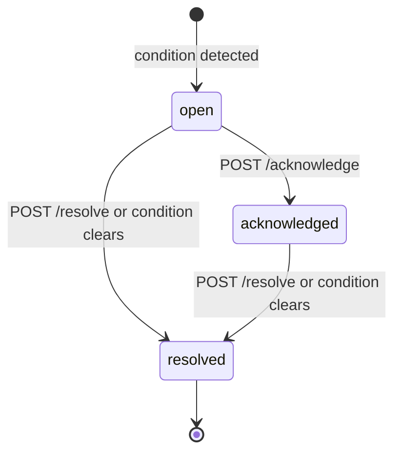

# Architecture

## Components

| File | Responsibility |
|---|---|
| `app/main.py` | FastAPI routes, lifespan (config validation → `init_db` → optional monitor task), one monitor cycle, dashboard hosting |
| `app/config.py` | Thresholds, intervals, DB URL from env; `validate_config()` fails fast on nonsense |
| `app/database.py` | SQLAlchemy 2.x engine + `SessionLocal`; `init_db()` creates tables idempotently |
| `app/models.py` | `MetricSnapshot`, `Incident`, `ServiceTarget`, `ServiceCheckResult` |
| `app/schemas.py` | Pydantic v2 request/response contracts |
| `app/metrics.py` | `collect_system_metrics()` — real `psutil` readings only, raises on failure |
| `app/monitor.py` | `evaluate_thresholds()` + `sync_incidents()` + ack/resolve/recovery helpers |
| `app/services.py` | Guarded HTTP checker: syntax validation, DNS resolution, policy check, manual redirect walk, body cap |
| `app/utils.py` | Single `utcnow()` clock + module loggers |
| `static/` | Dependency-free dashboard polling the API every 5 s (overlap-guarded) |

## Data flow

- **Metrics path:** background loop (or `GET /api/metrics/current`) → `psutil` →
  `MetricSnapshot(source="observed")` → `evaluate_thresholds()` →
  `sync_incidents(source="observed")`.
- **Service path:** background loop (or `POST /services/{id}/check`) →
  guarded `check_service(stored_url)` → `ServiceCheckResult` → record or
  resolve the `service:<name>` incident.
- **Demo path:** `POST /api/simulate` writes snapshots/incidents with
  `source="simulated"` through the *same* engine, so behavior is identical
  but origins never mix (`sync_incidents` only touches one source at a time).

## Incident lifecycle

- **Dedup key:** `cpu` / `memory` / `disk` / `service:<name>`. One active
  incident per key; repeat cycles update value/severity/timestamps.
- **Escalation:** warning → critical updates severity in place (never
  silently downgrades).
- **Recovery:** when a metric condition clears, the active incident is
  auto-resolved with `"Condition cleared; system recovered."` appended and
  `resolved_at` set. Service recovery works the same way on passing checks.

## Database schema (SQLite)

- `metric_snapshots(id, timestamp, cpu/memory/disk %, uptime_s, source)`
- `incidents(id, type, severity, title, description, observed_value,
  threshold, dedup_key, source, status, created/updated_at,
  acknowledged_at, resolved_at)`
- `service_targets(id, name UNIQUE, url, enabled, created_at)`
- `service_check_results(id, service_id FK, timestamp, status_code,
  response_time_ms, healthy, error)`

History is trimmed per monitor cycle (5000 snapshots / 2000 results).

## Key trade-offs

- **Polling + SQLite** instead of streaming TSDB: zero dependencies,
  explainable, sufficient for single-node demo scale.
- **Fail-closed SSRF policy** (any resolved IP blocked ⇒ whole check
  refused) over permissive connectivity: safer for a tool that fetches
  operator-configured URLs.
- **Same engine for simulated data** instead of a parallel mock system:
  demos exercise real code paths; `source` keeps the books straight.
